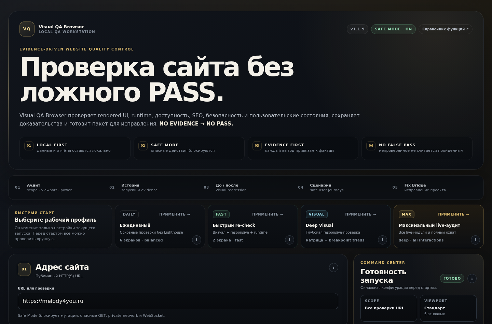
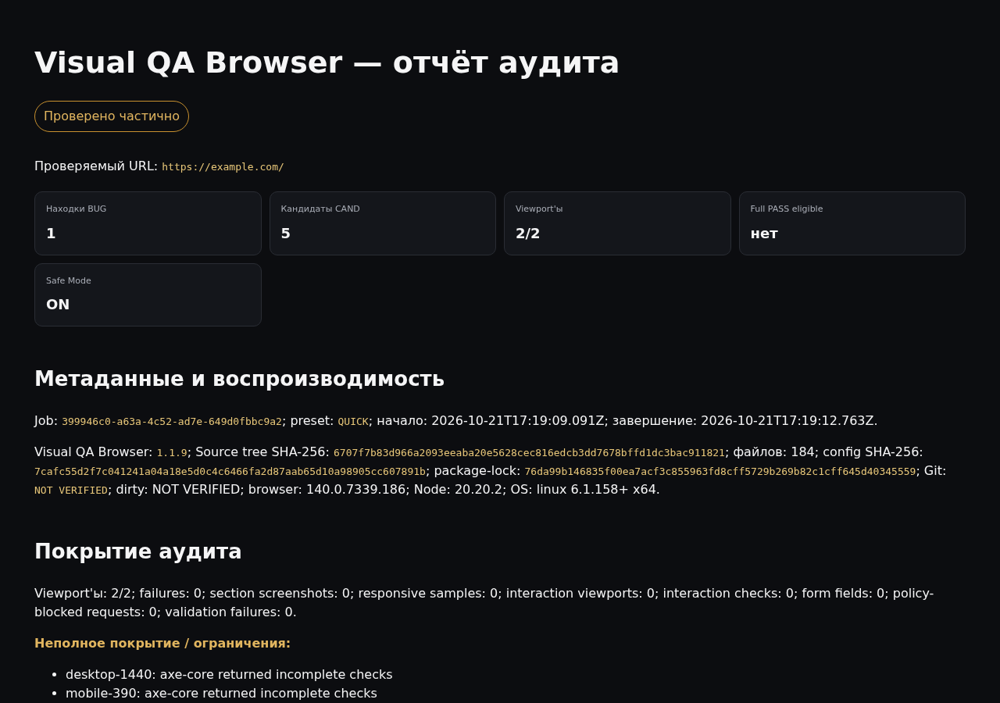

<h1 align="center">Visual QA Browser</h1>

<p align="center">
  <strong>Local-first, evidence-driven website QA workstation.</strong><br>
  Real rendered browser checks — visual, responsive, runtime, accessibility, SEO,
  passive security and performance — with screenshots behind every claim.<br>
  <strong>NO EVIDENCE → NO PASS.</strong>
</p>

<p align="center">
  <a href="https://github.com/Zagat007/visual-qa-browser/actions/workflows/ci.yml"></a>
  <a href="LICENSE"></a>
  
  
</p>

<p align="center">
  <a href="README_RU.md">🇷🇺 Читать на русском</a>
</p>



## What it is

Visual QA Browser launches a real Chromium (Playwright) against a site's
**rendered** pages, runs up to nine audit modules, and writes a report where
every confirmed defect (`BUG`) is tied to evidence — screenshots, coverage
data and machine-readable JSON. Anything it could not verify is labelled
`PARTIAL` or `NOT_VERIFIED`, never silently counted as passed.

It runs **entirely on your machine**: the server binds to `127.0.0.1` only,
reports stay in a local `reports/` folder, and nothing is uploaded unless
*you* explicitly configure the optional AI Art Director provider.



## What it checks

| Module | Highlights |
|---|---|
| **Visual** | Section/full-page screenshots, image & crop evidence, typography signals |
| **Responsive** | Viewport matrix, breakpoint −1/0/+1 probes, width sweep 320–1920, overflow/clipping geometry |
| **Forms** | Fields, labels and touch-target checks without submitting anything |
| **Interactions** | Safe state changes only; anything unsafe is `SKIPPED_SAFELY` |
| **Runtime** | Console and network errors with redacted, bounded evidence |
| **Accessibility** | axe-core; incomplete axe coverage downgrades the verdict honestly |
| **SEO** | Technical meta, robots.txt, sitemap, soft-404 detection |
| **Passive security** | HTTPS, HSTS, CSP, `nosniff`, Referrer-Policy, cookie Secure/HttpOnly/SameSite flags |
| **Performance** | Lighthouse in an isolated child process — 3 cold runs + median, watchdog-guarded |

Plus: **visual regression** against an approved local baseline (diffs stay
review *candidates*, never auto-BUGs), **safe user scenarios** (explicit steps,
network blocked after load), and export packages (`defects.json`,
`candidates.json`, `gpt-fix-prompt.txt`, `gpt-evidence.zip`) for handing
evidence to a human or an AI assistant.

## AI Art Director (advisory, never a verdict)

A separate layer grades premium-visual quality — hierarchy, imagery,
typography, emotional fit, conversion — against a transparent rubric and a
JSON **brand profile**. Facts (`PASS/ISSUE`) and taste (advisory scores) are
never mixed. Manual mode exports evidence + a prompt with zero uploads; the
optional OpenAI provider requires your own `OPENAI_API_KEY` and
`OPENAI_ART_DIRECTOR_MODEL`, refuses private/authenticated evidence, and marks
website text as untrusted input.

## AI Fix Bridge

Optionally, an audit can produce one source-aware ZIP for an AI assistant.
A returned fix package is imported only after fail-closed integrity checks
(manifest, source fingerprint, per-file SHA-256, project-path binding),
creates a sealed backup with rollback, applies only `replace`/`create`, and
**never executes project code**. Read [SECURITY.md](SECURITY.md) first.

## Quickstart

Requirements: **Node.js ≥ 22.19** (npm included) and internet access for the
one-time dependency/Chromium download.

### Windows

```bat
git clone https://github.com/Zagat007/visual-qa-browser
cd visual-qa-browser
INSTALL.bat   :: installs deps + Chromium, then runs full verification
START.bat     :: opens the local workstation
```

### Linux / macOS

```bash
git clone https://github.com/Zagat007/visual-qa-browser
cd visual-qa-browser
npm ci --ignore-scripts
npx playwright install chromium        # Linux: npx playwright install --with-deps chromium
npm run build
npm start                              # http://127.0.0.1:4210
```

Then audit any site **you own or are authorized to test**
(`example.com` is the safe default target).

## Safety model

- **Authorized use only.** This is a defensive QA tool, not a penetration-testing
  or exploitation framework — the security checks are passive by design.
- **Safe Mode is always on:** destructive actions, unsafe GETs, WebSockets and
  private-network targets are blocked; credentials in evidence are redacted.
- **Local only:** loopback binding + control-plane Host/origin checks.
  Do not expose the server through tunnels or port forwarding.
- Honest residual risk: application-level DNS/IP checks are not network-layer
  isolation. Details in [SECURITY.md](SECURITY.md).

## Honest limitations

- One URL per audit — no site-wide crawler yet (cross-page checks report
  `PARTIAL`); multi-page inventory is on the [roadmap](ROADMAP.md).
- Lighthouse is lab data, not field/RUM.
- No real-Safari/Firefox PASS claims; Chromium evidence only.
- The UI is currently Russian-language; English i18n is a top roadmap item
  (and a great first contribution — see
  [docs/GOOD_FIRST_ISSUES.md](docs/GOOD_FIRST_ISSUES.md)).

## Development

```bash
npm run dev            # API + Vite UI with hot reload
npm run typecheck      # strict TypeScript
npm test               # 163 tests (Vitest, real headless Chromium)
npm run static:check   # repository contracts
npm run build          # production build
npm run verify         # selftest + runtime smoke (release-integrity gate
                       # reports [NOT_RUN] in source checkouts by design)
```

Docs: [CONTRIBUTING.md](CONTRIBUTING.md) ·
[SECURITY.md](SECURITY.md) · [ROADMAP.md](ROADMAP.md) ·
[architecture notes](docs/ARCHITECTURE_LOCK.md) ·
[AI Art Director](docs/AI_ART_DIRECTOR.md) ·
[полный справочник функций (RU)](docs/FUNCTIONS_RU.txt) ·
[release history](docs/history/)

## Project status

v1.2.0 is the first public release, prepared from the private Windows package
v1.1.9-r24 (see [CHANGELOG.md](CHANGELOG.md)). Expect an alpha-level project
with an unusually paranoid test suite, maintained solo — issues and PRs are
genuinely welcome.

## License

[MIT](LICENSE) © 2026 Zagat007
